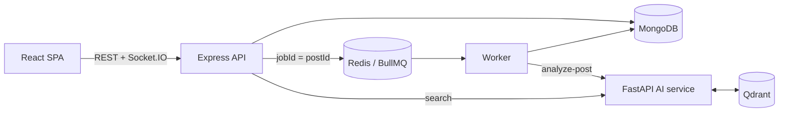

# Novak

**A photo-sharing app where you find posts by what their captions mean, not just the words they use.**

Search **"ocean animals"** and Novak returns *"Walruses napping on the beach"* and *"Orange jellyfish
drifting through the blue at the aquarium"*. Neither caption contains "ocean" or "animal".

<!-- Demo GIF goes here once recorded: publish → "Processing" badge → searchable → found by a paraphrase. -->


## The problem

Keyword search only finds the words people happened to type. On a labelled set of paraphrased
queries ("caffeine fix" for *"Third espresso of the day"*), MongoDB's `$text` search found nothing
for 45% of them. Adding semantic search raises a second set of problems, which most demos skip:

- The AI model is a network hop away and can be slow or down. Posting shouldn't depend on it.
- Background jobs get lost, duplicated, or retried forever.
- A vector index knows nothing about who may see which post.

Novak is a full-stack project built around those three problems. Every claim below is backed by a
test, a measurement or a report in this repo.

## Highlights

- **Publishing never waits on AI.** The API saves the post and returns 201. A BullMQ worker
  analyses it in the background, and a reconciler re-sends any job lost to a Redis or AI-service
  outage. Each step is idempotent and tested against real MongoDB and Redis.
- **Hybrid search, measured against the system it replaced.** Embedding hits above a tuned
  similarity floor come first, then MongoDB `$text` matches. On a labelled set: **nDCG@10 0.84 vs
  0.49** overall, and **0.81 vs 0.30** on paraphrased queries. CI fails if search quality drops
  below fixed floors.
- **The vector index can't leak a hidden post.** Search returns ids only, and the API re-reads
  them from MongoDB through the same visibility filter as the feed.
- **Honest AI.** Caption screening is labelled as keyword rules, because that's what it is. When
  the AI service fails, the API records a failure, never an approval.

There is no public deployment yet. To run it locally, see [Quickstart](#quickstart): one Docker
command, plus an optional demo-data script.

## Contents

[Status](#features-and-status) · [Architecture](#architecture) · [Results](#results) ·
[Tech stack](#tech-stack-and-why) · [Design decisions](#design-decisions-and-trade-offs) ·
[Quickstart](#quickstart) · [Tests](#tests) · [Limitations](#limitations-and-security-notes) ·
[Future work](#future-work) · [Docs](#docs)

## Features and status

| Capability | Implemented | Tested | Measured |
|---|---|---|---|
| Sign-up/login: argon2id, 15-min JWT, rotating refresh cookie with reuse detection | ✅ | integration | – |
| Posts, keyset-paginated feed, profiles, likes that stay correct under concurrency | ✅ | integration | [latency](docs/BENCHMARKS.md) |
| Background analysis: retries with backoff, terminal failure, author retry, reconciler | ✅ | integration (real Redis) | [throughput](docs/BENCHMARKS.md) |
| Caption embeddings (bge-small) in Qdrant; hybrid semantic + keyword search | ✅ | unit, contract, e2e | [quality](docs/SEARCH_EVAL.md), latency |
| Live processing status over Socket.IO, with reconnect re-fetch and polling fallback | ✅ | unit | – |
| Caption screening: **keyword rules** that flag for review only | ✅ | unit | not evaluated |
| Image understanding / image moderation | ❌ not implemented | – | – |
| Comments, follows, personalised ranking | ❌ not implemented | – | – |
| Public deployment | config only ([DEPLOYMENT.md](DEPLOYMENT.md)) | – | – |

<p align="center"></p>

## Architecture



1. **Publish:** the API saves the post with `processingStatus: pending` and returns 201. The post
   is visible straight away. Queueing the job takes at most 2 s, and fails fast if Redis is down.
2. **Analyse:** the worker sends the caption and tags to the AI service. The service checks the caption
   against keyword rules, embeds it with `BAAI/bge-small-en-v1.5` (384 dimensions, ONNX on CPU),
   adds zero-shot topic tags, and upserts the vector into Qdrant under an id derived from the post id.
3. **Record:** the worker marks the post `completed` (only if it isn't already) and pushes
   `post:processed` to the author. Transient errors retry with exponential backoff (5 s → 80 s).
   After 6 attempts, or on a 4xx, the post becomes `failed` and the author gets a Retry button.
4. **Recover:** every 60 s, the reconciler compares pending posts in MongoDB with BullMQ. It
   re-enqueues lost jobs and records failures the worker didn't get to write.
5. **Discover:** `/api/search` queries Qdrant (cosine ≥ 0.62) and MongoDB `$text` in parallel,
   hydrates the ids from MongoDB with the viewer's visibility filter, and lists semantic hits first.
   If one side fails, the other's results are returned and the response says which (`mode`).

More detail, including a failure-mode table, indexes, pagination and auth: [ARCHITECTURE.md](docs/ARCHITECTURE.md).

## Results

### Search quality

From the [full report](docs/SEARCH_EVAL.md): 62 captions and 36 hand-labelled queries. The
similarity threshold was chosen on a dev split and reported on a held-out split.

| System | nDCG@10 (all) | nDCG@10 (paraphrase queries) | Recall@5 | No-answer queries returning results |
|---|---|---|---|---|
| MongoDB `$text` (previous behaviour) | 0.494 | 0.303 | 0.508 | 1 / 6 |
| Semantic only, no floor | 0.920 | 0.914 | 0.886 | 6 / 6 |
| **Hybrid (shipped)** | **0.842** | **0.811** | **0.817** | 2 / 6 |

Semantic-only ranks best but returns confident-looking results for every query that has no
answer. The shipped hybrid gives up some ranking quality to fix that.

The dataset is small and I wrote it myself. The report lists where the model fails: for example,
"live music" ranks *"Listening to the storm…"* first.

### Performance

From the [full report](docs/BENCHMARKS.md). One laptop (Ryzen 5 5600H) ran every service and the
load generator, so treat these as relative numbers.

| Endpoint | p50 / p95, concurrency 1 | p50 / p95, concurrency 10 | Errors |
|---|---|---|---|
| `POST /api/posts` | 28 / 35 ms | 197 / 354 ms | 0% |
| `GET /api/posts/feed` | 6 / 8 ms | 52 / 66 ms (189 req/s) | 0% |
| `GET /api/search` (hybrid) | 35 / 55 ms | 172 / 249 ms | 0% |

- 300 posts were fully analysed and indexed 7.9 s after the last one was created (~21 posts/s).
- Feed queries read exactly the documents they return (`SORT_MERGE` over index ranges, no in-memory sort).

## Tech stack and why

| Layer | Choice | Why this one |
|---|---|---|
| Web | React 18, TypeScript, Vite, TanStack Query, Zustand, Tailwind | TanStack Query owns server state, so one live `post:processed` event can patch every cached copy of a post (feed, profile, search, detail) |
| API | Node 20, Express 4, TypeScript, Mongoose 8, Zod, Pino | Zod schemas are shared with the web app through `@novak/contracts`, so request and response shapes are checked on both sides |
| Jobs | BullMQ 5 on Redis 7 | Retries with backoff, and `jobId = postId` makes duplicate enqueues a no-op. The same Redis also backs rate limits and Socket.IO fan-out |
| Data | MongoDB 7 | Posts and authors are documents; compound indexes match the feed's sort exactly, and `$text` gives the keyword half of search for free |
| AI service | Python 3.11, FastAPI, FastEmbed (ONNX Runtime) | The ML tooling is in Python; ONNX runs the model on CPU, so it needs no GPU or paid API |
| Model | `BAAI/bge-small-en-v1.5` | A 67 MB model, about 5 ms per caption on a laptop CPU, and it beat keyword search clearly on the eval |
| Vectors | Qdrant 1.19 | Approximate nearest-neighbour search with payload filters (tag filter), and upserts by a deterministic id, which keeps re-indexing idempotent |
| Realtime | Socket.IO with the Redis adapter | Authenticated with the same access token as REST; works across API instances |
| Tooling | Vitest, Testing Library, supertest, pytest, ESLint, Prettier, ruff, Docker Compose, GitHub Actions | Integration tests run against real MongoDB and Redis, not mocks |

## Design decisions and trade-offs

| Decision | Why | What it costs |
|---|---|---|
| Analyse posts asynchronously ([ADR-002](docs/adr/ADR-002-async-ai-pipeline.md)) | Posting stays fast and keeps working when the AI service is down | A post is briefly public before its caption is screened |
| Reconcile from MongoDB instead of a transactional outbox ([ADR-003](docs/adr/ADR-003-reconciler-over-outbox.md)) | MongoDB already records each post's processing state; a periodic scan fixes every lost-job case with no extra collection | Recovery takes up to one reconciler interval (60 s) |
| Score floor (0.62) on semantic hits, with keyword matches appended | Without a floor, every no-answer query returned 10 results | Recall@5 drops from 0.886 to 0.817 |
| Hydrate search results from MongoDB | One visibility check for every read path; hidden or deleted posts can't come back through the index | One extra query per search |
| Keyset pagination on `(createdAt, _id)` | No duplicates or skips when new posts arrive; page cost doesn't grow with depth | No "jump to page N" |
| Like counter is a plain `+1`/`-1` per Like document | Stays equal to the number of likes under concurrent like/unlike (a guarded version drifted in CI) | The stored value can be `-1` for a moment; responses clamp it at 0 |
| Worker and reconciler run inside the API process | One deployable at this size | They scale with the API; [ARCHITECTURE.md](docs/ARCHITECTURE.md#what-id-change-at-larger-scale) says when to split them |
| Caption screening is keyword rules, labelled as such | No labelled data to train or evaluate a classifier; a fake "AI moderation" score would be worse | Low recall (never measured) |

## Quickstart

Prerequisites: Docker Desktop (or Docker Engine with Compose v2) and about 4 GB of free RAM.

```bash
git clone https://github.com/abhishekkamble12/Novak.git && cd Novak
docker compose -f infra/docker-compose.yml --profile app up -d --build --wait
node scripts/seed-demo.mjs        # optional: 12 demo posts with matching photos and captions
```

Open **http://localhost** and try Explore with *"ocean animals"*, *"morning coffee"* or
*"cooking dinner"*. The demo account is `novak_demo` / `DemoPassw0rd`.

- Use port 80, not 5173: in this setup 5173 serves only the static build, without the API proxy.
- The first build bakes the ~67 MB embedding model into the AI image, so it takes a few minutes.
- No `.env` is needed for Docker. Stop with `docker compose -f infra/docker-compose.yml --profile app down`.

| URL | What |
|---|---|
| http://localhost | Web app through the nginx gateway (serves the SPA, proxies `/api` and `/socket.io`) |
| http://localhost:3000/api/health | API readiness, including the analysis backlog |
| http://localhost:8000/health | AI service: model and Qdrant status |
| http://localhost:6333/dashboard | Qdrant dashboard |

<details>
<summary><b>Local development without the full Docker stack</b></summary>

Prerequisites: Node 20.11+ (see `.nvmrc`), npm 10, Python 3.11+, and Docker (for MongoDB, Redis and Qdrant).

```bash
cp .env.example .env
npm install
npm run infra:up                                   # MongoDB, Redis, Qdrant in Docker

cd apps/ai-service && python -m venv .venv
source .venv/bin/activate                          # Windows: .venv\Scripts\activate
pip install -r requirements-dev.txt && cd ../..

npm run dev        # terminal 1: contracts watcher + API (:3000) + web (:5173, proxies /api)
npm run dev:ai     # terminal 2: AI service (:8000), with the venv active
node scripts/seed-demo.mjs --base http://localhost:5173/api    # optional demo data
```

Image uploads are optional: set `VITE_CLOUDINARY_CLOUD_NAME` and `VITE_CLOUDINARY_UPLOAD_PRESET`
(an unsigned preset). Without them, posts take a public `https://` image URL.

</details>

## Tests

| Command | What it covers | Needs |
|---|---|---|
| `npm test` | API unit and cross-language contract tests (10); web tests for loading, error, empty and success states, processing badges, cache sync and the misrouted-API guard (15) | nothing |
| `npm run test:integration` | 39 API tests: refresh rotation and reuse, visibility on every read path, pagination with timestamp ties, concurrent likes (including a forced race), BullMQ retries, terminal failures, duplicate delivery, reconciler, Redis outage, hybrid-search hydration, body limits | `npm run infra:up` |
| `npm run test:ai` | 27 pytest tests: caption rules (including the old false positives), 503 on model or Qdrant failure, score floor, internal auth, contract fixtures | Python venv |
| `npm run eval:search` | Search evaluation; add `-- --check` to enforce the quality floors | venv (+ MongoDB for the `$text` baseline) |
| `npm run smoke` | Full journey against a running stack: publish → analyse → paraphrase search → visibility → like → delete | running stack |
| `npm run bench` | Load test ([method](docs/BENCHMARKS.md)) | running stack, `RATE_LIMIT_ENABLED=false` |
| `npm run lint`, `npm run format:check` | ESLint (typescript-eslint, React hooks rules) and Prettier; `ruff check` / `ruff format --check` for Python | nothing |

CI ([`.github/workflows/ci.yml`](.github/workflows/ci.yml)) has four jobs:
- typecheck, unit tests and the web build;
- integration tests against MongoDB and Redis service containers;
- Python lint, tests and the search-quality gate;
- a Docker Compose build followed by the smoke test.

<details>
<summary><b>Configuration</b></summary>

Every variable is documented in [`.env.example`](.env.example). The ones that matter:

| Variable | Default | Required in production? |
|---|---|---|
| `MONGO_URI`, `MONGO_DB_NAME`, `REDIS_URL` | local Docker | yes |
| `JWT_ACCESS_SECRET`, `JWT_REFRESH_SECRET`, `INTERNAL_API_SECRET` | dev placeholders | **yes**: random, 32+ characters; the API refuses to start otherwise |
| `CORS_ORIGIN`, `COOKIE_SAMESITE`, `TRUST_PROXY` | localhost / `lax` / 1 | set for your hosting |
| `AI_SERVICE_URL` | `http://localhost:8000` | yes |
| `ENABLE_WORKER`, `RECONCILE_INTERVAL_MS`, `RECONCILE_STALE_MS` | `true`, 60 s, 60 s | optional |
| `RATE_LIMIT_ENABLED` | `true` | keep `true` |
| `QDRANT_HOST`, `QDRANT_PORT`, `QDRANT_COLLECTION_POSTS` | `127.0.0.1`, 6333, `novak_posts_v2` | yes (AI service) |
| `EMBED_MODEL_NAME`, `SEARCH_MIN_SCORE` | bge-small, 0.62 | optional; re-run the eval if you change the model |
| `VITE_API_URL`, `VITE_SOCKET_URL`, `VITE_CLOUDINARY_*` | empty | optional |

Deploying to Railway and Vercel: [DEPLOYMENT.md](DEPLOYMENT.md).

</details>

<details>
<summary><b>Troubleshooting</b></summary>

| Symptom | Cause / fix |
|---|---|
| "The server returned something other than the Novak API" | `/api` isn't reaching the API. With Docker, open http://localhost (the gateway), not :5173 |
| Explore says "Keyword results only" | The AI service is down or its model didn't load: `curl localhost:8000/health` |
| Posts stay "Processing" | Check `curl localhost:3000/api/health`. If `pipeline.pendingPosts` keeps growing, the API can't reach the AI service or Qdrant; posts are retried, then marked failed |
| `Integration tests need MongoDB and Redis` | Run `npm run infra:up`, or set `TEST_MONGO_URI` / `TEST_REDIS_URL` |
| API exits with `Invalid environment configuration` in production | A secret is missing, too short, or still a placeholder from `.env.example` |
| Port already in use | Another MongoDB, Redis or Qdrant is running; stop it or change the ports in `infra/docker-compose.yml` |
| Slow first AI start (local dev) | It's downloading the embedding model (~67 MB) into `apps/ai-service/.cache` |

</details>

## Limitations and security notes

- **Search reads captions only.** Images are never analysed, so a photo with no caption or tags is
  never semantically searchable. The model is small and English-centric; known failure cases are
  in [SEARCH_EVAL.md](docs/SEARCH_EVAL.md).
- **Caption screening is a keyword list, not a model.** It catches a few explicit and spam phrases
  and holds matches for review (hidden from others; the author sees why). Its recall has never been
  measured. Nothing sets the `rejected` status yet.
- **Optimistic publishing:** a post is public before its caption is screened. That's usually a few
  seconds, longer if the AI service is down.
- **The eval set is small and self-written** (62 captions, 36 queries), so it shows large
  differences reliably, not small ones.
- The AI service trusts its network, plus the `X-Internal-Secret` header when `AI_ENV=production`.
  Don't expose it publicly.
- Image URLs are user-supplied and served as-is: there's no media proxy or upload scanning.
- The API refuses compressed request bodies (415) and bodies over 100 kB (413).
- **Accepted advisory:** Zod 3 is affected by [GHSA-mrhx-c7xc-m3w5](https://github.com/advisories/GHSA-mrhx-c7xc-m3w5)
  (validation issues pile up per invalid array element; fixed only in Zod 4). The 100 kB body limit
  bounds it: the worst request that fits (50,000 invalid tags) costs about 45 ms of CPU and 16 MB of
  short-lived heap, and requests are rate-limited per IP. Migrating to Zod 4 changes `.default()`
  semantics across all three packages, so it's a planned change rather than a hotfix.

## Future work

- **Image-aware search:** embed the photo itself (CLIP) as a second vector, so uncaptioned posts
  become searchable, evaluated on a public image-caption benchmark.
- **A public deployment**, following [DEPLOYMENT.md](DEPLOYMENT.md).
- A trained caption classifier, evaluated on labelled data, plus a review queue for flagged posts.
- At larger scale: run the worker and reconciler as their own deployment with a leader lock, run
  more uvicorn workers or batch embeddings, and store the model version with each vector so a model
  change can trigger a re-index.

## Repository layout

```
apps/api             Express + TypeScript: routes, Mongoose models, BullMQ worker, reconciler
  test/integration   supertest suites against real MongoDB + Redis
  scripts/           explain-queries.ts (MongoDB query plans for the hot paths)
apps/ai-service      FastAPI: caption rules, FastEmbed embedder, zero-shot tagger, Qdrant store
  eval/              labelled dataset, evaluation script, results.json
  tests/             pytest
apps/web             React 18 + Vite + TanStack Query + Tailwind
packages/contracts   Zod schemas shared by API and web, plus cross-language fixtures
infra/               Docker Compose (data stores + full stack) and the nginx gateway
scripts/             bench.mjs (load test), smoke.mjs (end-to-end check), seed-demo.mjs (demo data)
docs/                architecture, API, search evaluation, benchmarks, ADRs, screenshots
```

## Docs

- [Architecture](docs/ARCHITECTURE.md): components, post lifecycle, failure handling, indexes, auth
- [API reference](docs/API.md)
- [Search evaluation](docs/SEARCH_EVAL.md): dataset, baselines, threshold choice, failure cases
- [Benchmarks](docs/BENCHMARKS.md): method, environment, results, query plans
- [Deployment](DEPLOYMENT.md): Railway + Vercel
- ADRs: [001 Docker Compose for local dev](docs/adr/ADR-001-docker-compose-local-dev.md) ·
  [002 Async AI pipeline](docs/adr/ADR-002-async-ai-pipeline.md) ·
  [003 Reconciler over outbox](docs/adr/ADR-003-reconciler-over-outbox.md)

Demo photos are from [Unsplash](https://unsplash.com), served by [Lorem Picsum](https://picsum.photos).

## License

[MIT](LICENSE) © 2026 Abhishek Kamble
