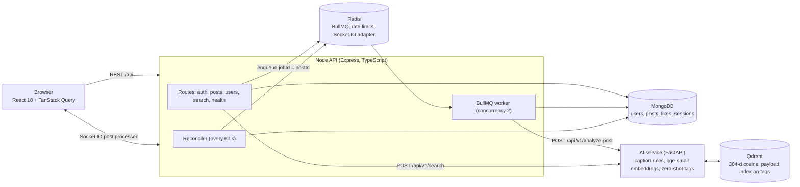
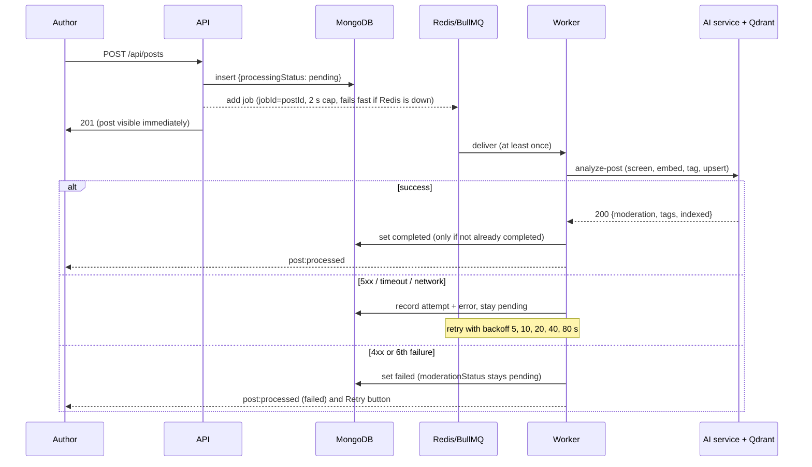
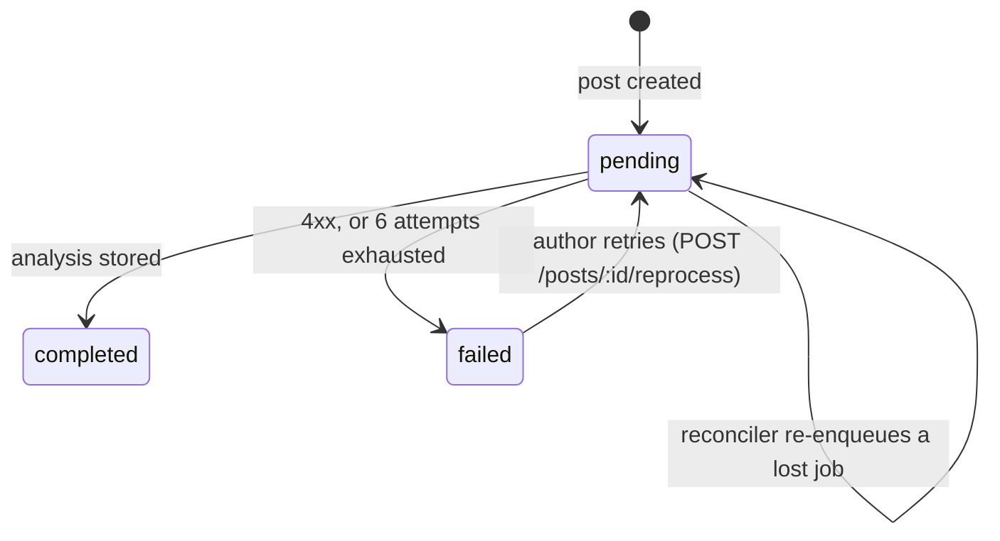

# Architecture

## Running system

| Component | Responsibility | Why it's separate |
|---|---|---|
| Node API | Auth, posts, feed, likes, visibility, search orchestration, job worker | Owns the product data and every authorization decision |
| AI service | Caption screening, embedding, tagging, vector upsert and query | The ML stack (ONNX runtime, FastEmbed, numpy) is Python. It's stateless apart from Qdrant, so it scales and fails independently |
| MongoDB | Source of truth, including each post's processing state | Document model fits posts and authors; the indexes match the feed's sort |
| Redis | Job delivery (BullMQ), rate-limit counters, Socket.IO fan-out across instances | Never the source of truth; losing it delays analysis but loses no data |
| Qdrant | Vector index for caption embeddings | Purpose-built ANN search with payload filters (tag filter) |

The AI service never decides who sees a post. It returns post ids and scores, and the API
**hydrates them from MongoDB with the viewer's visibility filter**. A post that was flagged,
rejected or deleted after indexing can't leak through search.

## Post lifecycle

Processing state, separate from moderation:

### Failure handling

| Failure | Behaviour | Verified by |
|---|---|---|
| Redis down when posting | Enqueue rejects within 2 s; post saved as pending; reconciler enqueues it later | `redisDown.int.test.ts`; manual outage (201 in 215 ms) |
| Job lost from Redis | Reconciler finds the pending post with no job and enqueues it | `pipeline.int.test.ts` |
| AI service or Qdrant down | AI service returns 503 (never "200, not indexed"); BullMQ retries | `test_inference_api.py`, `pipeline.int.test.ts`; manual Qdrant outage |
| Model not loaded | analyze → 503 (retry); search → 503 → API serves keyword results with `mode: "keyword"` | `test_inference_api.py`, `posts.int.test.ts` |
| Retries exhausted / 4xx | Post `failed`; author sees "Not searchable yet · Retry" | `pipeline.int.test.ts`, `PostCard.test.tsx` |
| Worker dies before recording a terminal failure | Reconciler sees the failed job and marks the post | `pipeline.int.test.ts` |
| Duplicate delivery | Completed posts are skipped; the Qdrant upsert is keyed by post id | `pipeline.int.test.ts` |
| Post deleted during analysis | Worker detects the missing post and deletes the vector it just wrote | `pipeline.int.test.ts` |
| Socket event missed | Client re-fetches posts after every reconnect, and polls every 15 s while own posts are pending | `realtime.test.ts` |

## Data model and indexes

`posts`: `author, caption, mediaUrl, tags, aiTags, likesCount, moderationStatus, moderationReason,
processingStatus, processingAttempts, processingError, searchIndexed, createdAt`

| Index | Serves |
|---|---|
| `{moderationStatus: 1, createdAt: -1, _id: -1}` | Public feed (two `$in` ranges merged in sort order) |
| `{author: 1, createdAt: -1, _id: -1}` | Profile grid; the "own posts" branch of the signed-in feed |
| `{createdAt: 1}` partial on `processingStatus: "pending"` | Reconciler scan and the backlog count in `/api/health`; holds only unprocessed posts |
| text `{caption, tags, aiTags}` | Keyword half of hybrid search and the fallback |
| `likes {user: 1, post: 1}` unique | Idempotent like (upsert); `hasLiked` lookups |
| `sessions.expiresAt` TTL | Expired refresh sessions removed by MongoDB |

Plans are in [BENCHMARKS.md](BENCHMARKS.md#query-plans-mongodb-7-400-posts).

### Feed pagination

Keyset (cursor) pagination on `(createdAt, _id)`, newest first. The cursor is
base64url(`{timestamp, id}`), and the next page is
`createdAt < t OR (createdAt = t AND _id < id)`. Unlike `skip/limit`, posts created while a user
scrolls don't shift later pages (no duplicates or skips), and the cost of a page doesn't grow
with its depth. `_id` breaks ties between posts created in the same millisecond. Tests cover
25 posts sharing one timestamp, and a post inserted between page requests.

### Likes

A like is an upsert on the unique `(user, post)` index; the counter is incremented only when
the upsert inserted a document. 20 concurrent likes from one user give `likesCount = 1`, and a
concurrent like/unlike storm leaves the counter equal to the number of like documents (tested).

## Authentication

- Access token: 15-minute HS256 JWT in memory (never in localStorage), sent as a Bearer header
  and in the Socket.IO handshake.
- Refresh token: httpOnly cookie scoped to `/api/auth`, carrying a session id and token id (jti).
  Only the jti's SHA-256 is stored. Every refresh rotates the jti with a compare-and-swap.
  Presenting an old jti means the token was replayed, so the whole session is revoked.
- Passwords: argon2id. Unknown usernames are verified against a dummy hash, so response
  timing doesn't reveal which accounts exist.
- Authorization lives in one place: `visibilityFilter(viewerId)` is applied to feed, profile,
  detail, likes and search hydration. Delete and retry check ownership.

## Search

`GET /api/search?q=` calls the AI service and MongoDB `$text` in parallel:

1. Embed the query (bge-small with its retrieval instruction); Qdrant cosine top-k with
   `score_threshold = 0.62`.
2. Hydrate those ids from MongoDB with the viewer's visibility filter.
3. Append `$text` matches that aren't already in the list.

If the AI service fails, the keyword results are returned alone with `mode: "keyword"`, and the
UI says semantic search is unavailable. The evaluation is in [SEARCH_EVAL.md](SEARCH_EVAL.md).

## What I'd change at larger scale

- Run the worker and reconciler as their own deployment, with a leader lock on the reconciler.
- Multiple uvicorn workers or batched embedding for search; cache query embeddings.
- Feed: precomputed per-user timelines once there are follows. Today's single global feed is
  one indexed range scan.
- Replace the caption keyword rules with a trained text classifier evaluated on labelled data,
  plus a human review queue for `flagged` posts (the `rejected` state exists but nothing sets
  it yet).
- Store the embedding model version with each vector, so a model change can trigger a
  backfill re-index.
